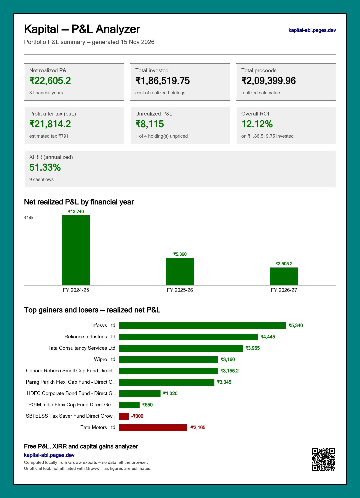

# Kapital

**Your Groww P&L, XIRR and capital gains in 10 seconds — in your browser.**

[](LICENSE)
[GitHub](https://github.com/krazylearner/kapital) · [Issues](https://github.com/krazylearner/kapital/issues)

Kapital reads Groww CSV/XLSX exports and turns them into FY-wise realized and
unrealized P&L, ROI, XIRR and capital-gains tax estimates — then renders a
shareable summary image. Everything runs client-side: no upload, no login, no
cookies, no backend.

> Unofficial and independent. Not affiliated with Groww. Tax figures are
> estimates — verify with your CA before filing.



## What it does

- Realized P&L with FIFO lot matching, charges and split/bonus handling
- Unrealized P&L from holdings exports (no live prices are fetched)
- Indian financial-year breakdown (April–March) with cumulative net P&L
- XIRR across all buy/sell cashflows plus current value of open holdings
- Capital-gains tax estimates, including the 23 Jul 2024 regime change
  (legacy vs current STCG/LTCG rates, equity/debt, LTCG exemption)
- Per-instrument and open-holdings tables
- Shareable PNG summary + a QR/link back to the app

## Supported inputs

Drag any combination of these into the app:

| Export | Examples |
| --- | --- |
| P&L report | `sample_equity_pl_report.csv` |
| Mutual fund statement | `sample_mf_statement.csv` |
| Holdings export | `sample_holdings.csv` |
| Capital gains report | `sample_capital_gains.csv` |
| Equity tradebook | CSV/XLSX |

Use **Load sample data** to try it without any real exports.

## Run locally

No build step, no dependencies to install:

```sh
python -m http.server 8080
# open http://localhost:8080
```

Opening `index.html` directly also works, but a local server makes file
handling and sharing behave like production.

## Deploy

The repo is static — no build command, no output directory, no environment
variables.

### Cloudflare Pages (recommended)

1. Cloudflare dashboard → **Workers & Pages → Create → Pages → Connect to Git**
2. Pick `krazylearner/kapital`, production branch `main`
3. Framework preset **None**, build command **empty**, output directory **`/`**
4. Deploy. Every push to `main` redeploys; every PR gets a preview URL.

The repo already ships:

- `_headers` — CSP, HSTS, `nosniff`, referrer/permissions policy, cache rules
- `_redirects` — `/index.html` → `/`, `pages.dev` and `www` → apex domain
- `404.html` — returns a real 404 status with a styled page

### GitHub Pages

Settings → Pages → deploy from `main` / root. Note that GitHub Pages ignores
`_headers` and `_redirects`; you keep `404.html` only.

### Custom domain

Add the custom domain in the Pages project, then create the DNS records at your
registrar. This repo never touches DNS — that step is yours.

### After the domain is live

1. Update the domain in the four places listed below.
2. Verify the site in Google Search Console and submit `/sitemap.xml`.
3. In Cloudflare, **disable Rocket Loader** and leave Bot Fight Mode off for the
   zone — both break this app's JS and can block crawlers.
4. Make sure `og-image.png` resolves at the domain you put in `index.html`,
   otherwise link previews will be blank.

Before going live, set your domain in these four places:

- `js/config.js` → `siteUrl` (share image QR code, caption, share links)
- `index.html` → `canonical`, `og:url`, `og:image`, `twitter:image`, JSON-LD `url`
- `robots.txt` → `Sitemap:`
- `sitemap.xml` → `<loc>`

## Privacy

Parsing, calculation, charts and image generation all happen in `js/*.js` in
the browser tab. There is no `fetch`/XHR of user data anywhere in the codebase.
Verify it yourself: open DevTools → Network, load your exports, and watch that
no request carries them. The only external requests are the CDN assets
(98.css, Chart.js, SheetJS, qrcode-generator).

## Project layout

```
index.html        shell, SEO/OG metadata, dialogs
404.html          styled 404
_headers          CSP, HSTS, security and cache headers (Cloudflare Pages)
_redirects        301 rules (Cloudflare Pages)
css/style.css     Win98-themed styling
js/config.js      brand, domain, repo — edit this first
js/parsers.js     CSV/XLSX detection and normalization
js/calc.js        FIFO matching, FY aggregation, XIRR, tax estimates
js/charts.js      in-app charts
js/share.js       summary image, QR code, captions, share intents
js/samples.js     sample exports for demos and tests
js/app.js         UI wiring and rendering
tools/og-image.html   regenerates og-image.png (open it, then click Save)
tools/share-preview.png  sample summary image for this README
```

## Contributing

Issues and PRs welcome. Useful first contributions:

- More broker/export formats (Zerodha, Upstox, INDmoney, ICICI Direct)
- Accuracy fixtures for tax edge cases
- Accessibility and mobile polish
- Additional languages

Please keep the client-side-only constraint: no server, no telemetry that reads
file contents.

## License

MIT — see [LICENSE](LICENSE).
